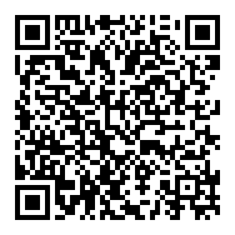

# Mario Kart Wii 3DS: Local Wireless

Local wireless multiplayer for [MiniBandit's Mario Kart Wii 3DS port](https://github.com/MiniBandit/MKW-3DS),
like Mario Kart 7's local play: one console hosts, the others join, and you race
together in VS with everyone choosing their own driver and kart.

This repository is **only a patch and a build script**. It contains no game
files and none of the port itself. You build a small **update CIA** (about 3 MB)
from the builder folder you already used to build the game.

**Full transparency: MKW-3DS-LocalWireless has been made with heavy help from an AI assistant (Claude)**

## Features

- **Host / Join** from *Multiplayer* in the main menu; the lobby shows how many
  players are connected
- Host settings: **CPUs on/off** and **engine class** (50cc, 100cc, 150cc, Mirror)
- Host presses **START**: every console goes straight to character selection
- Everyone picks their own **driver, kart and drift mode**; the host picks the course
- **License names** above karts
- **Items synchronised**: item boxes, hits and thrown items
- After a race the host chooses what's next; guests see the results and follow
- If the host leaves, guests take over the remaining racers; a guest who stops
  responding is replaced by a CPU
- **Performance**: steadier 60 fps in 2D and a stable 30 fps in 3D (on new 3ds, hasn't yet been tested on OLD models) (lighter
  shadows and effects, better GPU scheduling, earlier detail switching for CPUs)

Network play uses the 3DS's own local wireless (UDS): no router or internet needed.

## Requirements

- The game **already built** with [MiniBandit/MKW-3DS](https://github.com/MiniBandit/MKW-3DS)
  **v0.7.0**, and that builder folder still on your computer (it reuses its
  toolchain and build files)
- **Git** (https://git-scm.com), only to build the update yourself
- Every console that plays needs the game installed and this update CIA on top

## Build the update CIA yourself

```
git clone https://github.com/12TROLL14/MKW-3DS-local-multiplayer
cd MKW-3DS-local-multiplayer
python3 build_update.py /path/to/MKW-3DS
```

On Windows use `py build_update.py C:\path\to\MKW-3DS`.

The script checks the builder version, applies `local-wireless.patch`, compiles,
writes `out/MKW-3DS-LocalWireless-Update.cia`, and then removes the patch again,
so your builder folder stays exactly as MiniBandit's.

Options:

| | |
|---|---|
| `--overlay` | Build with the debug overlay (SELECT in a race: frame rate, GPU timings and network statistics). Writes `...-Update-overlay.cia` |
| `--keep-patched` | Leave the patch applied in the builder folder |
| `--jobs N` | Number of compile jobs |

If devkitPro isn't in its default place, set `DEVKITPRO` first.

## Install

Every console needs the game already built and installed with
[MiniBandit's builder](https://github.com/MiniBandit/MKW-3DS) v0.7.0. Then
install the update over it, on each console:

| | |
|---|---|
| **FBI**: Remote Install → Scan QR Code |  |
| **Manually**: download `MKW-3DS-LocalWireless-Update.cia` from the [latest release](../../releases/latest) and install it with FBI | |
| **Build it yourself** (see above) and install `out/MKW-3DS-LocalWireless-Update.cia` | |

The update contains no game files and can't run without your own build. To go
back to the normal game, install MiniBandit's official update.

## Play

1. **Main menu → Multiplayer** on every console.
2. One console chooses **Host**, the others **Join**.
3. The host sets CPUs and the engine class, then presses **START** once everyone
   has joined.
4. Pick your driver, kart and drift mode. Guests then wait on the cup page while
   the host picks the course; the race starts on all consoles together.

## Status and limits

- Tested with two New 3DS XL consoles.
- The network code is written for up to 12 players; three or more consoles and
  leaving mid-race haven't been tested yet.
- VS races only: no Grand Prix, battle or team races in multiplayer.
- Every console must run the same update (the lobby ignores other versions).

Bug reports are welcome in Issues: say how many consoles, which models, and the
steps to reproduce.

## Credits

- **MiniBandit**, **dudewhat** and **Epic (Epic0522)**: the Mario Kart Wii 3DS port
  and its builder, and everyone credited in
  [its README](https://github.com/MiniBandit/MKW-3DS#credits)
- **vabold / Kinoko**: Mario Kart Wii physics
- **devkitPro, libctru and Citro3D**: 3DS development libraries

## License

The patch and script are MIT-licensed (see [LICENSE](LICENSE)). They modify the
MKW-3DS port, whose own files keep their own terms: see that project's LICENSE
and NOTICE.

Mario Kart Wii is © Nintendo. This is an unofficial fan project, not affiliated
with Nintendo. Don't share built CIAs: everyone builds their own from their own disc.
